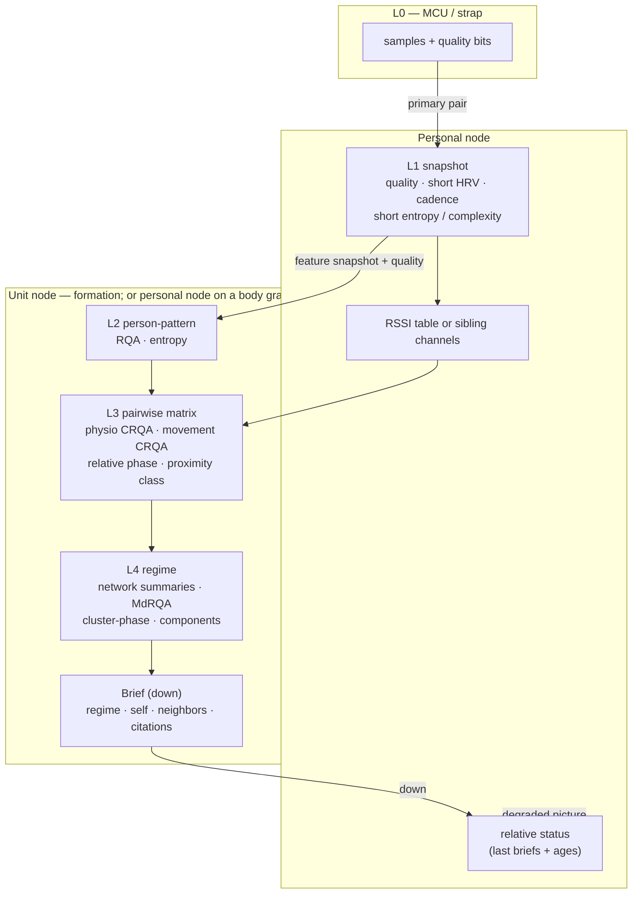
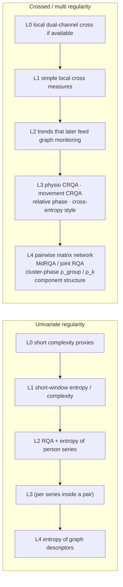
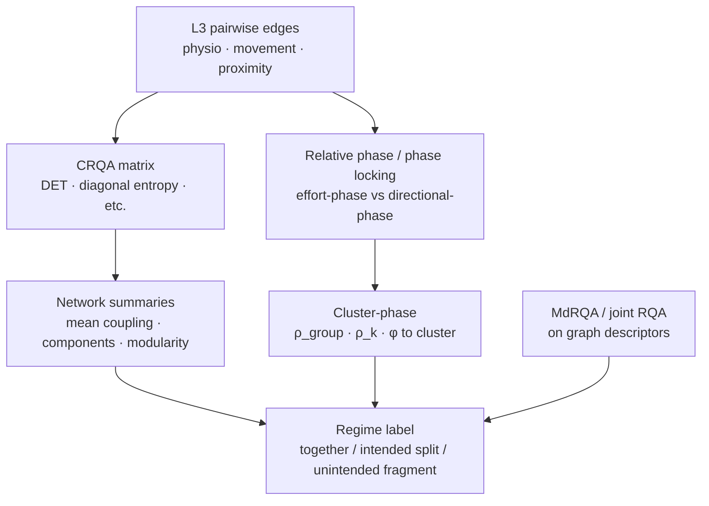

# Diagrams — contracts and analytics

Scaffold diagrams. Nothing here is implemented.

## 1. Contract object flow (up / down)



**Text equivalent**

```text
MCU/strap (L0 samples + quality)
        │  primary pair (many channels per sid allowed)
        ▼
Personal node
  L1 snapshot (quality, short HRV, cadence, short entropy)
  RSSI table / sibling channels
  relative status (last briefs)
        │  features + quality   (raw on pull only)
        ▼
Unit node (formation) or the same personal node (body graph)
  L2 person-pattern (RQA, entropy)
  L3 pairwise matrix (physio, movement, relative phase, proximity)
  L4 regime (network + MdRQA + cluster-phase + components)
        │
        ▼
  Brief ──► back (relative status or self-cue)
```

## 2. Analytics by layer — univariate vs crossed / multi regularity

Every layer assesses **both** univariate regularity and crossed / multi
regularity. Higher layers may also request more detailed data.



| Layer | Univariate regularity | Crossed / multi regularity |
|:------|:----------------------|:---------------------------|
| **L0** | Short complexity proxies | Local dual-channel cross if two sensors exist |
| **L1** | Short-window entropy / complexity, short HRV | Simple local cross; trends for a cue or upstream |
| **L2** | RQA + entropy of the longer series | Features the graph will use to monitor that node |
| **L3** | Per-series descriptors inside each pair | Physio CRQA, movement CRQA, relative phase, causal effort vs directional phase |
| **L4** | Entropy (and RQA) of the graph descriptors | Network summaries, MdRQA / joint recurrence, cluster-phase, component count → regime |

## 3. In-phase / out-of-phase path (L3 → L4)



```text
L3 pairwise edges
  ├─ relative phase / phase locking (effort vs directional)
  └─ CRQA matrix ──► network summaries (components, mean coupling)
         │
         ▼
L4  cluster-phase (ρ_group, ρ_k, relative phase to cluster)
    + MdRQA / joint RQA on graph descriptors
    + entropy of those descriptors
         │
         ▼
    regime: together | intended split | unintended fragment
```

## 4. Request path for more detailed data

```text
Higher layer (unit node / later archive)
        │  request (schema + quality required)
        ▼
Personal node / L0
        │  may return longer windows, higher-rate segments,
        │  extended diagnostics, extra cross measures
        ▼
Requester decides trust from quality + schema version
```

Default remains the narrow feature bus. The capability is architectural;
policy is out of scope.

## See also

- [analytics.md](analytics.md)
- [architecture.md](architecture.md)
- [contracts.md](contracts.md)
